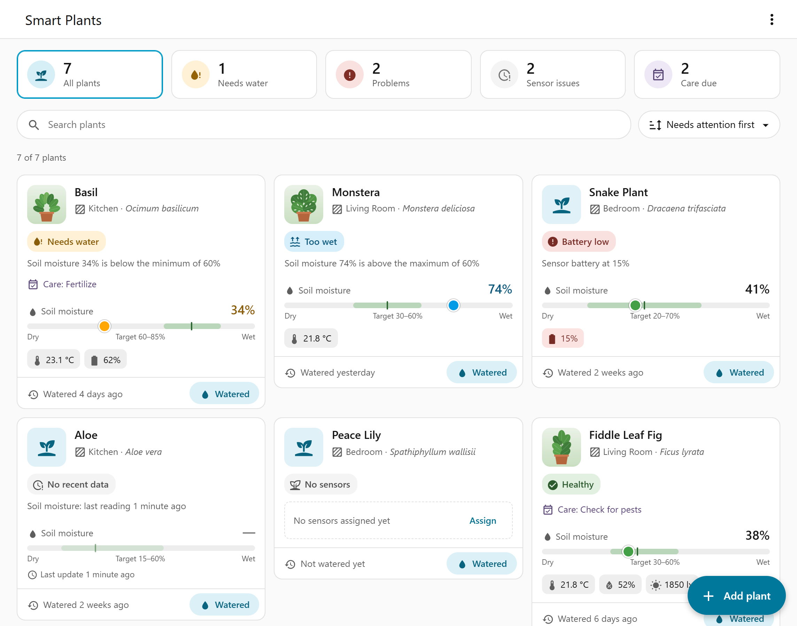

# Smart Plants for Home Assistant

Smart Plants makes each of your plants a Home Assistant device. You add a plant in a sidebar
panel and assign the sensors you already have. Each plant then gets a status such as
*Needs water* and entities for your automations and dashboards. No YAML or template sensors
needed.

## Features

- **Plants as devices.** Each plant has its own area, photo and entities. Sensors are inputs
  you can replace, so the plant keeps its history when you change hardware.
- **Eight sensor types.** Soil moisture, temperature, humidity, illuminance, conductivity,
  soil temperature, CO2 and battery. Several sensors can feed one reading.
- **One status per plant.** *Needs water*, *Too wet*, *Low light* and other problem sensors,
  plus a health score. You can change every threshold per plant.
- **Care log.** Log watering, fertilizing, pruning, repotting, pest control and notes. The
  **Watered** button logs a watering with one tap.
- **Automations without entity IDs.** Smart Plants triggers, conditions and actions work with
  plants, areas, labels or all plants at once.
- **Dashboard card.** Shows a plant with its status, readings and a **Watered** button, also
  for users who aren't administrators.

Optional, when you need them:

- **Care reminders.** Repeating tasks, yearly tasks, and tasks that follow a sensor or the
  weather forecast, such as a frost warning.
- **Notifications.** A daily plant report or a message when a plant needs water, set up from
  the panel.
- **Snooze.** Mute a plant's alerts while you're on vacation.
- **Species data from [OpenPlantBook](https://open.plantbook.io/).** Look up a species and
  review its targets before you apply them.

Smart Plants never switches valves or pumps. Your automations decide what to do.

## Installation

Smart Plants needs Home Assistant 2026.8.0 or newer.

1. Open the repository with the button above, or search for **Smart Plants** in
   **Settings > Marketplace** (Home Assistant 2026.11 and newer) or in **HACS** (older
   versions).
2. Install it. The Marketplace opens the setup right away. With HACS, restart Home Assistant
   first.
3. If the setup didn't open, add the integration:

   

Manual installation, updates and removal are in [Installation](docs/installation.md). Before
you update, check that your backups include the Smart Plants data. An older version can't read
data written by a newer one, see
[Roll back to an earlier version](docs/installation.md#roll-back-to-an-earlier-version).

## Quick start

1. Open **Smart Plants** in the sidebar. The panel is for administrators.
2. Select **Add plant**, enter a name and pick an area.
3. Pick a soil moisture sensor, or select **Skip for now**.
4. Select **Create plant**.

The plant now has a status, and its entities are ready for automations. See
[Getting started](docs/getting-started.md) for the full tour.

## Documentation

- [Installation](docs/installation.md): Marketplace, HACS and manual install, options,
  updates, backup and removal
- [Getting started](docs/getting-started.md): the panel, your first plant, sensors and
  thresholds
- [Care](docs/care.md): care log, care reminders and rest periods
- [Sensors and health](docs/sensors-and-health.md): how readings become a status
- [Entities](docs/entities.md): every entity and attribute
- [Automations](docs/automations.md): triggers, conditions, actions and examples
- [Notifications](docs/notifications.md): ready-made notifications from the panel
- [Dashboard card](docs/dashboard-card.md)
- [OpenPlantBook](docs/openplantbook.md)
- [Troubleshooting](docs/troubleshooting.md) and [FAQ](docs/faq.md)

## Help and contributing

Report bugs in [GitHub issues](https://github.com/mikekuss/home-assistant-smart-plants/issues)
and attach the diagnostics download. To contribute code or a translation, see
[CONTRIBUTING.md](CONTRIBUTING.md).

## License

[MIT](LICENSE). The bundled panel includes [Lit](https://lit.dev/) (BSD-3-Clause), see
[THIRD_PARTY_LICENSES.txt](custom_components/smart_plants/frontend/THIRD_PARTY_LICENSES.txt).

Smart Plants is not affiliated with or endorsed by Home Assistant, Nabu Casa or OpenPlantBook.
