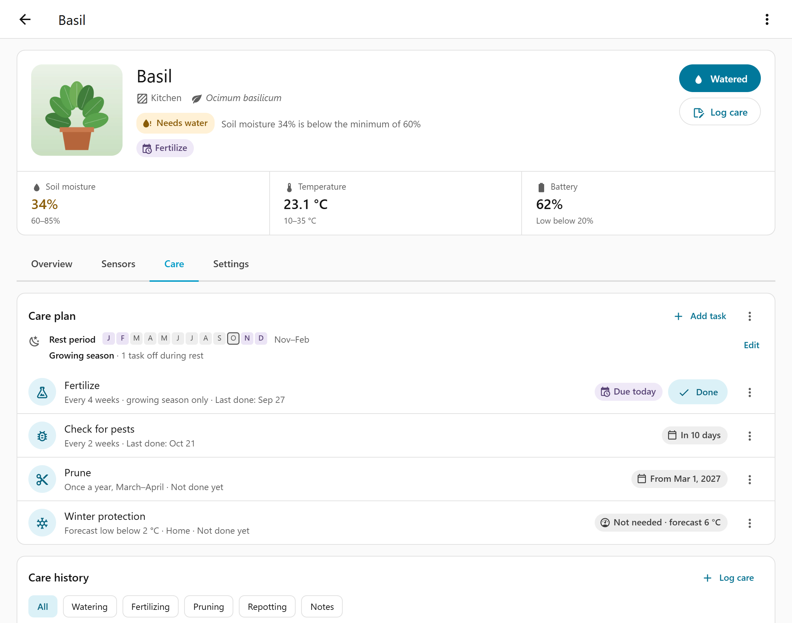
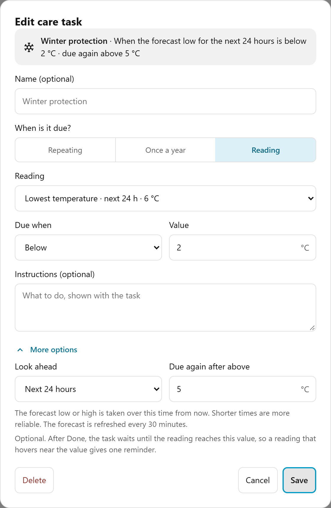

# Care

Each plant has a care log and an optional care plan with reminders. Both are on the plant's
**Care** tab. Care tasks never change the plant's health status.

## Log care

Select **Log care** in the plant's header or on the **Care history** card. Pick the care type,
set the date and time (not in the future), add details and select **Record care**.

| Care type | Details |
| --- | --- |
| Watering | Note |
| Fertilizing | Product, amount in g or mL, note |
| Pruning | Part pruned, note |
| Repotting | Container, medium, note |
| Pest control | Pest, product, note |
| Note | Text, required, up to 1,000 characters |

Notes take up to 500 characters, other details up to 120. The **⋮** menu of an entry edits or
deletes it. Chips at the top of **Care history** filter by type once there is more than one.

A **watering** keeps *Needs water* off for 24 hours from the time of the entry, so the soil
sensor can catch up. A fertilizing, pruning or repotting entry also marks the matching care
task as done.

Each plant keeps up to 256 entries. Beyond that, Smart Plants removes the oldest watering
first, then the oldest note, then the oldest entry that isn't the latest of its type. All
plants share one storage file of at most 8 MiB. When it's full, the panel shows "Smart Plants
storage is full" until you delete old entries.

To log care from an automation, for example with an NFC tag, use the
[`smart_plants.log_care`](automations.md#actions) action.

## Add a care task

A care task reminds you of care that comes back. A plant can have one task of each type
(**Fertilize**, **Prune**, **Repot**, **Check for pests**, **Winter protection**) plus custom
tasks, up to 20 in total.

Select **Add task**, pick the type and choose when it is due:

- **Repeating.** Every so many days, weeks, months or years (1 to 999), counted from the last
  Done or skip. With a rest period, **Only in the growing season** lets the task wait during
  the rest months.
- **Once a year.** A range of months, such as March to April or November to February. If the
  range ends without a Done, the task shows *Missed this year*.
- **Reading.** Due when a sensor or the forecast is below or above a value, see
  [Reading tasks](#reading-tasks).

A custom task needs a name of up to 60 characters. **Instructions** take up to 4,000
characters. Under **More options** you can enter when the task was last done. Without that
date, a repeating task is due right away.

When the species comes from OpenPlantBook with care notes, **Add task** first shows
**Suggestions**, for example **Add Fertilize task** or **Add winter protection**. A suggestion
opens the task with the note as instructions.

## Work with tasks

Each task shows its schedule, last Done and state, for example *Due today*, *Overdue 3 days*
or *In 2 weeks*. Select **Done** on a due task. The **⋮** menu has more:

- **Mark as done…** opens the care form with a date and note.
- **Skip this time** counts the task as handled for now. It offers **Undo**.
- **Edit** changes name, schedule, instructions or the last Done date. The type stays.
- **Automate…** shows the task's entity IDs and opens the automation editor.
- **Delete** removes the task and its entities. The care log keeps its entries.

Due tasks also show as chips in the plant's header. Each task has its own entities, see
[Care tasks](entities.md#care-tasks).

## Reading tasks

A reading task is due because of a value, not a date. **Winter protection** starts as one:
due when the temperature is below a value.

In the task editor:

- **Reading.** One of **This plant's sensors**, **Any other sensor…**, or **Weather forecast**
  when Home Assistant has a weather entity with a forecast. A plant sensor follows the plant's
  reading, so the task keeps working when you replace the sensor. Battery isn't offered.
- **Due when.** **Below** or **Above** a **Value**.
- **Only after** (under **More options**). The reading must stay on the due side for this many
  hours, 0 to 72. A restart starts the count again.
- **Due again after** (under **More options**). After Done, the task waits until the reading
  passes this value. This gives one reminder for a cold spell instead of several.

When the species has a minimum temperature from OpenPlantBook, the editor offers it as the
value.

A reading task shows one of these states:

| State | Meaning |
| --- | --- |
| *Not needed · 9 °C* | The reading is on the safe side. |
| *Below 5 °C since 8:10 PM · due 10:10 PM* | **Only after** is counting. |
| *Due · 3 °C* | The task is due. |
| *Done Nov 12 · still cold* | Done, waiting for the reading to pass **Due again after**. |
| *No reading* | The sensor gives no number. The task keeps its state until a reading arrives. |

If the reading passes **Due again after** (or the value itself, without it) before you select
**Done**, the task stops being due.
Reading tasks have no **Skip this time** and no next due date, and they keep running during a
rest period.

### Get a frost warning from the forecast

A reading task can watch the weather forecast instead of a sensor. It then warns you before the
cold arrives, also for plants without a temperature sensor.

1. Add **Winter protection** and pick **Lowest temperature · next 24 h** as the reading.
2. Set **Below** 2 °C.
3. Under **More options**, set **Due again after** above 5 °C.

The task is due when the forecast low for the next 24 hours drops below 2 °C, and it waits for
a low above 5 °C before it can be due again. **Highest temperature** works the same way for a
heat warning.

**Look ahead** under **More options** sets 24 hours, 2 days or 3 days. **Only after** isn't
offered for forecasts. Smart Plants picks hourly, twice daily or daily forecasts by itself, and
refreshes the forecast at the **Forecast refresh interval** from the
[options](installation.md#options) and when the weather entity changes.

The task shows states such as *Not needed · forecast 6 °C*, *Due · forecast 1 °C* or *No
forecast*. *Forecast only until …* means the forecast ends before the look-ahead does.

## Set a rest period

A rest period pauses tasks such as fertilizing during the months a plant rests. Most
houseplants don't need one.

1. Open the care plan's **⋮** menu and select **Set rest period**.
2. Select the first and the last rest month. A rest period can run past December but not cover
   the whole year.
3. Choose the repeating tasks that are **Off during rest**. Fertilizing is selected for a new
   rest period.

A task off during rest shows *Resting until* *date* and is due again on the first day of the
growing season. Once-a-year tasks, reading tasks and watering alerts don't change. **Edit**
changes the rest period, and **Remove** in the editor clears it.
