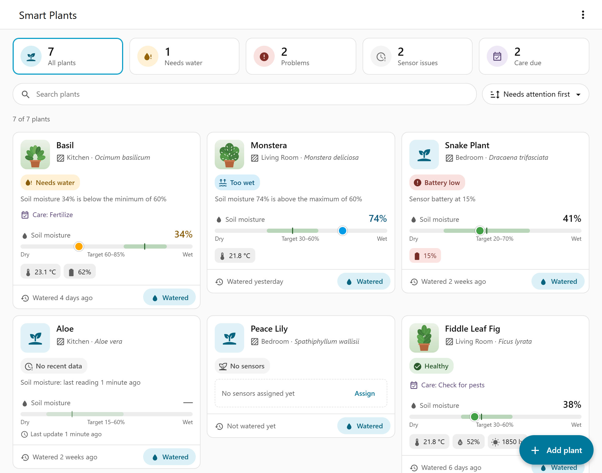
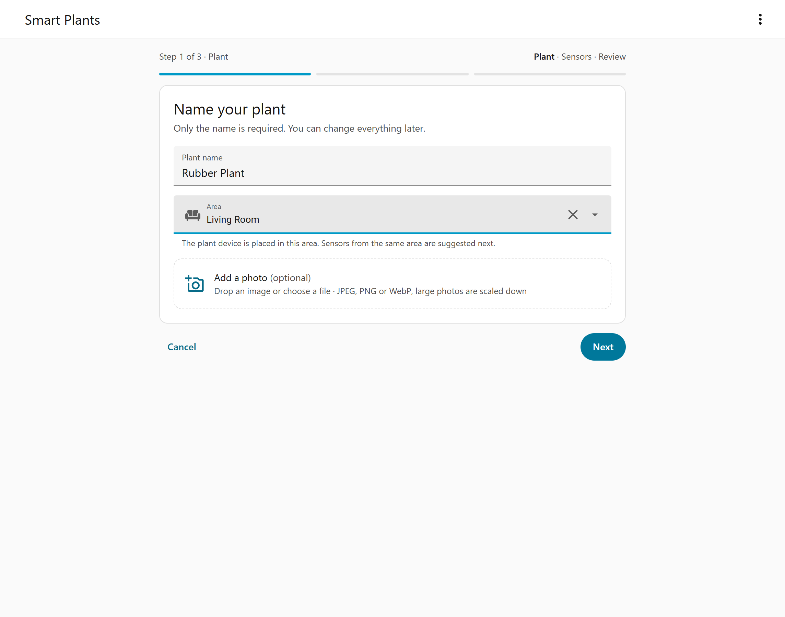
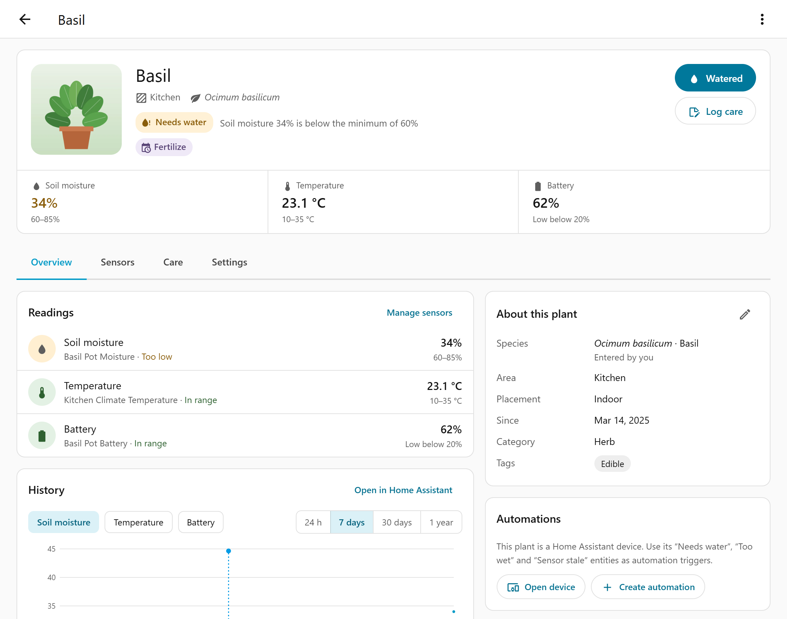
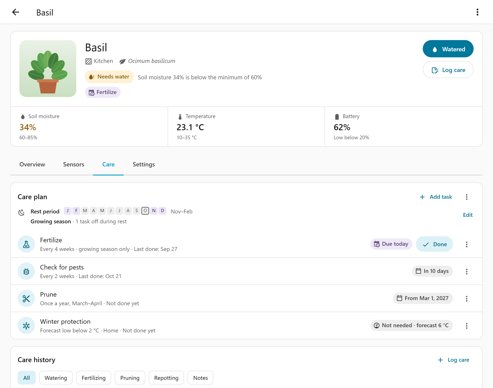

# Getting started

This guide walks you through the Smart Plants panel: creating your first plant, assigning
sensors, adjusting thresholds, logging care, and managing plants over time.

## The Smart Plants panel

After you [add the integration](installation.md#add-the-integration), **Smart Plants**
appears in the Home Assistant sidebar (sprout icon). The panel is available to
**administrator** accounts only; non-admin users don't see it.



The overview shows:

- four summary tiles: **All plants**, **Needs water**, **Problems** (too wet, or another
  reading outside its target such as too little light or a low sensor battery) and
  **Sensor issues** (no recent data, or no soil moisture sensor assigned). Once a plant has a
  care task, a fifth tile, **Care due**, counts the plants with a care task due today or
  overdue. Select a tile to show only those plants; select it again to show all plants.
- a search field that matches plant name, area, species (scientific name and common names in
  English and German), category and tags, and a sort menu:
  **Needs attention first** (the default), **Name**, or **Group by area**.
- one card per plant with its photo, area and species, a status label with a short
  explanation (for example *Soil moisture 34% is below the minimum of 60%*), the soil
  moisture on a bar with its target range, the current value of every other assigned
  sensor, and when the plant was last watered. A plant without sensors shows **Assign**,
  which opens its **Sensors** tab. When care tasks are due, one line names them, for example
  *Care: Prune, Fertilize +1*.

Each plant has one status, most urgent first: *Needs water*, *Too wet*, a named problem
(such as *Too little light* or *Battery low*), *No recent data*, *No moisture sensor* (or
*No sensors* when nothing is assigned), *Healthy*.
Paused plants show *Paused*.

Select **Watered** on a card to log a watering right now. A message confirms it and offers
**Undo** for a few seconds.

Use **Add plant** at the bottom right (or **⋮ → Add plant** in the top bar) to start the
creation wizard. Select a plant's name to open its page. The **⋮** menu also links to the
integration options and this documentation.

## Create your first plant

The wizard has three steps. It saves nothing until you select **Create plant**, and you can
go back at any time without losing your entries. Only the name is required.



1. **Plant** – Enter a name and optionally choose a Home Assistant **Area**. The plant's
   device is placed in that area, and sensors from the same area are suggested in the next
   step. You can also add a photo: drop an image on the photo field or choose a file (JPEG,
   PNG, or WebP up to 5 MB). It is uploaded right after the plant is created.
2. **Sensors** – Pick a **Soil moisture sensor**; it gives the plant its watering alerts. The
   list only shows moisture sensors, with their current values. Under **Suggested from**
   *area*, other sensors from the chosen area are listed with what they measure and their
   current value; select **Add** to use one. **Add another sensor** lets you pick a sensor for
   temperature, humidity, light, fertilizer level, soil temperature, CO₂, or battery. The
   button reads **Skip for now** until you choose a sensor; you can add sensors later.
3. **Review** – Check the summary and use **Edit** to change a step. Without a soil moisture
   sensor, a warning reminds you that there are no watering alerts. Two optional sections
   hold everything else:
   - **Species and watering targets** – Search [OpenPlantBook](openplantbook.md) (at least
     three characters), pick a result, check the imported information, and tick
     **I reviewed and accept this species information**. Nothing is applied without this.
     If OpenPlantBook is not set up, the section explains where to add its credentials. You
     can also type a common and scientific name yourself. The soil moisture targets
     **Needs water below**, **Ideal**, and **Too wet above** show the Smart Plants defaults,
     or the species values once accepted; change a value to override it for this plant.
   - **More details** – Date acquired, placement (indoor, outdoor, balcony, greenhouse,
     covered outdoor, or dormant storage), category, and tags. Sun exposure, rain exposure,
     and container can be set later on the plant page under **Settings** →
     **More details**.

   Select **Create plant**.

Smart Plants creates one Home Assistant device for the plant, with its moisture and health
entities and every sensor you picked, in a single step. Each picked sensor becomes the main
sensor for its reading, so values show up right away. The confirmation offers **Open plant**,
**Back to plants** and **Add another plant**.

If the connection drops while the plant is being created, the wizard keeps the request and
offers **Retry same creation request**. Retrying never creates a second plant.



## The plant page

Select a plant on the overview to open its page. The header shows the photo, name, area,
species, the plant's status with every current reason, and up to four key readings with
their target range. Two buttons sit next to it:

- **Watered** logs a watering right now, with **Undo** in the notification.
- **Log care** opens the care form in the **Care** tab.

The **⋮** menu in the top bar offers **Open device**, **Download diagnostics**,
**Pause monitoring** (or **Resume monitoring**) and **Delete plant**. The back arrow returns to
the overview.

The page has four tabs:

- **Overview** – *Readings* (each assigned reading with its sensor, whether it is in range,
  too low, too high or not updating, and its target), *History* (a chart of one reading over
  time, see [History](#history)), *Recent care* (the last three entries),
  *About this plant* (species, area, placement, date acquired, category and tags) and
  *Automations* (links to the device page and to a new automation for this device).
- **Sensors** – the sensors in use, the settings for readings with several sensors, and
  *Troubleshooting*.
- **Care** – the care plan with your care reminders, and the care log.
- **Settings** – name, area, photo, species, soil moisture targets, other targets, more
  details, and pausing or deleting the plant.

### History

The *History* card on the **Overview** tab charts one reading of the plant over time. It
appears as soon as the plant has at least one assigned sensor.

- Pick the reading with the buttons above the chart (shown when the plant has more than one)
  and the time range with **24 h**, **7 days**, **30 days** or **1 year**. Your choice is
  remembered in the browser.
- The line is the average value. The light area around it is the lowest to highest value of
  each hour or day. The green band is the target range; a dashed line marks the ideal soil
  moisture.
- A dotted vertical line marks each logged watering on the soil moisture chart, and each
  logged fertilizing on the fertilizer level chart.
- Point at the chart to read the value at that time. With the keyboard, focus the chart and
  use the arrow keys.
- For soil moisture, the line below the chart says how fast the value is dropping since the
  last watering (or since it last rose), for example *Dropping about 5.5% per day*, and
  estimates when it reaches the minimum at that rate. The estimate needs at least twelve hours
  of readings after the last rise and is not shown for the **1 year** range.
- **Open in Home Assistant** opens Home Assistant's own dialog for the plant's sensor, with its
  chart and the link to the History page.

The chart shows the plant's own sensor entity (for example *Monstera Soil moisture*), so it
continues across a sensor replacement. The data comes from Home Assistant's long-term
statistics; see the [FAQ](faq.md#how-far-back-does-the-history-chart-go).

## Assign sensors

Open the plant and go to the **Sensors** tab.

- **Assigned sensors** lists every sensor the plant uses by its Home Assistant name, with its
  current value and when it last reported. The **⋮** menu of a sensor changes the sensors of
  that reading, makes it the main sensor when a reading has several, or removes it from the
  plant.
- **Add sensor** lists the readings that have no sensor yet: soil moisture, temperature,
  humidity, light, battery, fertilizer level (conductivity), soil temperature and CO₂. Pick
  one, add one or more sensors and save.
- **Several sensors for one reading** (collapsed) lists every reading with a short summary.
  Select **Change** to set **Combine readings** (which value counts when more than one sensor
  is assigned: **Main sensor only**, **Average**, **Lowest** or **Highest**), which sensor is
  the **Main sensor**, and **Not updating after**: how many seconds without an update make a
  sensor count as not updating.

When the soil moisture sensor stops reporting, a warning at the top of the tab names the
sensor and when it last reported.

The sensor picker is filtered by device class and unit for each reading. Tick
**Show all sensors, including ones that don't look like a match** to pick anything else, or
type an entity ID and press Enter to assign a sensor that is currently unavailable. Each reading accepts up to 32
sensors.

A reading's sensor and problem entities appear the first time you assign a sensor to it. See
[Sensors and health](sensors-and-health.md) for accepted units and how values are combined.

## Edit thresholds

Open the plant and go to the **Settings** tab.

- **Soil moisture targets** – **Needs water below**, **Ideal** and **Too wet above**. The card
  says whether the values come from the species or from the Smart Plants defaults. Leave a
  field empty to use the default, or select **Reset to defaults**, then **Save targets**. The
  plant's *Moisture minimum*, *Moisture target* and *Moisture maximum* number entities change
  the same values.
- **Other targets** (collapsed) lists each configured check other than soil moisture (for
  example *Temperature stress* or *Low battery*) with its current limits. Select
  **Edit thresholds**, change values, and **Save thresholds**. **Inherit all built-in
  defaults** resets that check.

The editors validate the order of values (for example, the "clear" value must sit between
the trigger value and the normal range) before saving. Built-in defaults are listed in
[Sensors and health](sensors-and-health.md#built-in-thresholds).

## Log care

Open the plant and select **Log care** in the header or on the **Care history** card in the
**Care** tab. Choose a care type, set the date and time (your local time, not in the future),
fill in the optional details, and select **Record care**. The chips at the top of the
**Care history** card (All, Watering, Fertilizing, Pruning, Repotting, Notes) filter the
entries.

| Care type | Details you can record |
| --- | --- |
| Watering | Note |
| Fertilizing | Product, amount with unit (g or mL), note |
| Pruning | Part pruned, note |
| Repotting | Container, medium, note |
| Note | Text (required, up to 1000 characters) |

Notes can be up to 500 characters and other details up to 120. The **⋮** menu of an entry
edits or deletes it. An entry that marks a care task as done keeps its care type when you edit
it; pest checks and custom tasks appear under the task's name. Each plant keeps up to 256 care entries; after that, the oldest
waterings are removed to make room (see
[Troubleshooting](troubleshooting.md#old-care-entries-disappeared)).

Logging a **watering** pauses the plant's *Needs water* alert for 24 hours from the time you
entered, giving the soil sensor time to catch up. See
[Sensors and health](sensors-and-health.md#manual-watering-grace).

When the plant has a care task of the same type, a fertilizing, pruning or repotting entry
also marks that task as done; the form says so below the care type.

## Care plan

The **Care plan** card at the top of the **Care** tab holds reminders for recurring care:
fertilizing, pruning, repotting, checking for pests, winter protection, and tasks of your own. A plant can have
one task of each type plus any number of custom tasks, up to 20 in total. Care tasks never
change the plant's health status.



Select **Add task**, pick what you want to be reminded of, then choose when it is due:

- **Repeating** – every so many days, weeks, months or years. The next date counts from the
  day you last marked the task as done or skipped it, early or late. When the plant has a
  rest period, **Only in the growing season** lets the task wait during the rest months.
- **Once a year** – a range of months, for example March to April. Select the first month,
  then the last; a range can run past December, such as November to February. The task is due
  from the first day of the range to its end. If the range passes without a Done, the task
  shows *Missed this year* and opens again the next year.
- **Reading** – when a sensor reading is below or above a value, for example when the
  temperature is below 5 °C. See [Reading tasks](#reading-tasks).

A custom task needs a name; other tasks can keep their default name. **Instructions** are
optional and can hold up to 4,000 characters. Under **More options** you can enter when the
task was last done; without a date, a repeating task is due right away.

When the plant's species comes from OpenPlantBook and has care notes, **Add task** first shows
**Suggestions** with the species' fertilizing and pruning notes. **Add Fertilize task** or
**Add Prune task** opens the task with the default schedule and the note as its instructions;
you can change both before saving. Long notes show three lines with **Show more**. While you
add or edit a fertilizing, pruning or repotting task with empty instructions, **Use as
instructions** copies the matching note (for repotting, the soil note). The notes are stored
with the species, so suggestions work without a new OpenPlantBook request, and nothing is
added to a task until you select it.

Each task shows its schedule, when it was last done, and its state, for example *Due today*,
*Overdue 3 days*, *In 2 weeks*, *From Mar 1* or *Done for this year*. Dates are calendar dates
in your Home Assistant time zone. When a task is due, **Done** marks it as done now, with
**Undo** in the notification. The task's **⋮** menu offers:

- **Mark as done…** – opens the care form, where you can pick another date and add a note.
- **Skip this time** – the task counts as handled for now, with **Undo** in the notification.
- **Edit** – change the name, schedule, instructions or last done date. The task type stays.
- **Automate…** – the entity IDs of the task, a hint for the `smart_plants.log_care` action, and
  a button that opens the automation editor.
- **Delete** – asks first. The task's entities are removed, so automations that use them stop
  working; its entries in the care history are kept.

Due tasks also appear as small chips under the plant's status in the header, at most two
followed by *+N*.

### Reading tasks

A reading task is due because of a sensor reading instead of a date. **Winter protection**
starts as one ("When it gets cold"): below a temperature on the plant's temperature sensors.

- **Reading** – pick one of **This plant's sensors** (every assigned sensor role except
  battery, with its current value) or **Any other sensor…**, which opens a sensor picker for
  sensors with a numeric state. A plant sensor follows the role, so replacing the sensor behind
  it on the **Sensors** tab keeps the task working, and it compares in the role's unit (°C, %,
  lx, µS/cm or ppm). Another sensor compares in the unit it reports when you save the task.
- **Due when** – **Below** or **Above**, and the **Value**, with the unit shown next to it.
- **More options** – **Only after**: the reading must stay on the due side this many whole
  hours (0 to 72) before the task is due; after a Home Assistant restart the wait starts
  again. **Due again after above** (or **below**): after Done, the task waits until the
  reading passes this value instead of the value itself, so a reading that hovers around the
  value gives one reminder. It must be on the other side of the value.

The summary at the top reads the rule back, for example *When the temperature is below 5 °C ·
for 2 h · due again above 12 °C*. When the species comes from OpenPlantBook with a minimum
temperature, a temperature reading set to **Below** shows *OpenPlantBook: minimum 5 °C* with
**Use**; the value is converted into the sensor's unit first, for example 41 °F. **Add task**
also suggests **Add winter protection** with that minimum, or says *Already in the care plan*.

A reading task shows its rule, for example *Below 5 °C · Temperature*, and one of these
states:

- *Not needed · 9 °C* – the reading is on the safe side.
- *Below 5 °C since 8:10 PM · due 10:10 PM* – the reading is on the due side and **Only after** is
  still counting.
- *Due · 3 °C* – the task is due; **Done** marks it as done.
- *Done Nov 12 · still cold* or *Done Nov 12 · until above 12 °C* – done, and waiting until the
  reading is back on the safe side. Then the next cold spell makes it due again.
- *No reading* – the sensor is unavailable or doesn't report a number. The task keeps its
  state until a reading arrives.

If the reading moves back to the safe side before you mark the task as done, it stops being
due by itself. Reading tasks have no **Skip this time** and no next due date, and they keep
running during a rest period.

### Rest period

Many outdoor and Mediterranean plants grow little in winter and need no fertilizer then; most
houseplants don't need a rest period. To set one, open the Care plan card's **⋮** menu and
select **Set rest period**. Select the first rest month, then the last; a rest period can run
past December, such as November to February, but can't cover the whole year. Below the
months, choose which repeating tasks are **Off during rest**; for a new rest period,
fertilizing is selected. Once-a-year tasks follow their own months, and watering alerts are
not affected.

The card then shows a rest row with the twelve months (rest months tinted, the current month
outlined) and one sentence, for example *Growing season · 1 task off during rest* or
*Resting until Mar 1 · 1 task off*. A task that waits shows *Resting until Mar 1* and is due
again on the first day of the growing season, even if it was overdue before. **Edit** in the
rest row changes the rest period; **Remove** in the editor clears it, and the tasks keep their
setting for a later rest period.

Every task has its own entities for automations; see [Entities](entities.md#care-tasks). To mark
a task as done from an automation, for example from an NFC tag, use the
[`smart_plants.log_care`](automations.md#log-care-with-actions) action.

## Plant photos

Add or change a photo in the **Settings** tab under **Photo** (or during creation).

- Formats: JPEG, PNG, or WebP.
- Photos larger than 2048 × 2048 pixels or 5 MiB, such as photos straight from a phone
  camera, are scaled down in your browser before upload (up to 40 MiB and 64 megapixels).
  The photo keeps its aspect ratio and orientation.

Smart Plants re-encodes every photo to WebP and strips metadata such as EXIF (including
location data) before storing it locally. Photos are only served to logged-in administrators.
Select **Remove photo** to delete it.

## Edit plant details

The **Settings** tab lets you change the name (**Rename**), the Home Assistant area
(**Change area**) and the species. Placement, date acquired, category and tags are under
**More details**. Renaming a plant also renames its Home Assistant device; the entity IDs stay
the same. The area is the same one shown on the device page in Home Assistant.

If another browser session saves changes to the same plant while you are editing, the panel
pauses saving and shows what changed, so you don't overwrite each other.

## Pause, resume, or delete a plant

In the **Settings** tab under **Manage**, or from the **⋮** menu:

- **Pause monitoring** stops evaluation for the plant. Its entities stay registered but become
  unavailable, and its history is kept. Use this for plants in storage or temporarily without
  sensors.
- **Resume monitoring** starts evaluation again.
- **Delete plant** permanently removes the plant, its device and entities, its photo, and its
  care history. You are asked to confirm first. This cannot be undone.

Automations you wrote are never changed by Smart Plants. After deleting a plant, update any
automations that used its entities.

## Going on vacation

While you're away, a plant may need water that nobody can give it, and reminders would only
pile up. Open the plant, choose **⋮ → Snooze alerts…** and pick how long: 1 day, 3 days, 1 week,
2 weeks, or **Until date…** for any day from tomorrow up to a year ahead. The snooze lasts until
the end of that day in Home Assistant's time zone, so **1 day** means until the end of tomorrow.

While a plant is snoozed, its header shows a grey **Snoozed until Fri, Oct 30** chip next to the
status with a **Resume** button, and its card on the overview shows the same chip. The menu
entry then reads **Change snooze…**, where you pick a new end or resume. The status, the
counts, and the care reminders stay as they are.

To snooze several plants at once, use the `smart_plants.snooze` action, for example from
**Developer tools → Actions** or a script you run before leaving:

```yaml
action: smart_plants.snooze
target:
  device_id:
    - 0123456789abcdef0123456789abcdef
    - fedcba9876543210fedcba9876543210
data:
  until: "2026-11-15 18:00:00"
```

The plants keep their real states and still count in the panel. Their binary sensors get the
attribute `snoozed: true`, which your notification automations can check to stay quiet (see
[Snooze alerts](automations.md#snooze-alerts)). The snooze ends by itself at the given time;
`smart_plants.unsnooze` ends it earlier.

## Next steps

- [Sensors and health](sensors-and-health.md) – how values and problems are calculated.
- [Entities](entities.md) – what each plant exposes to Home Assistant.
- [Automations](automations.md) – notification and irrigation examples.
