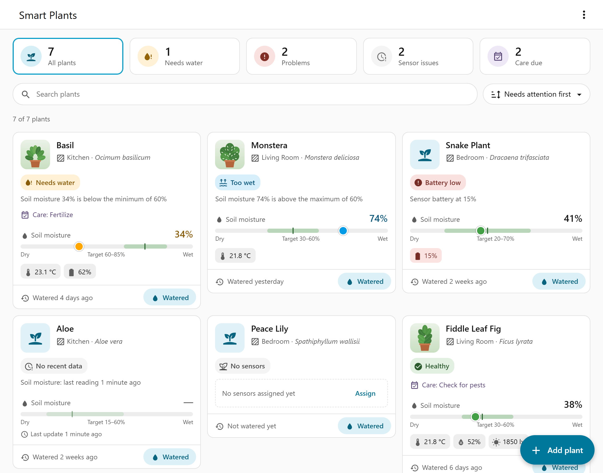
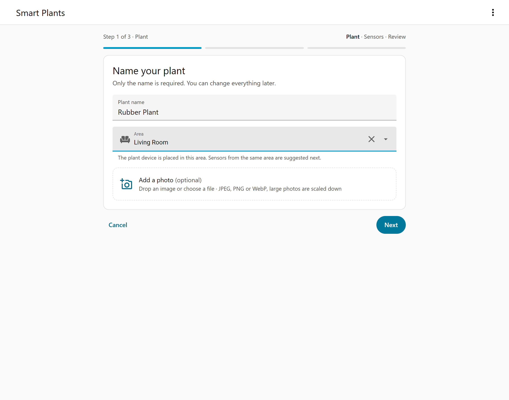
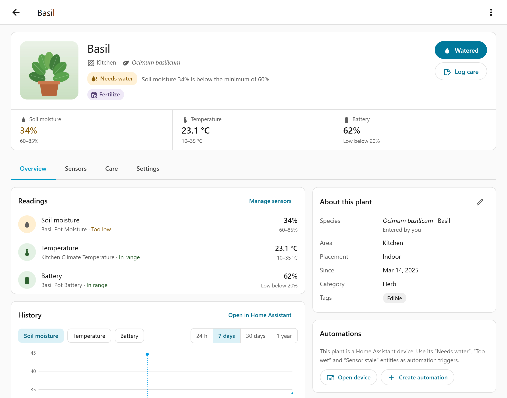
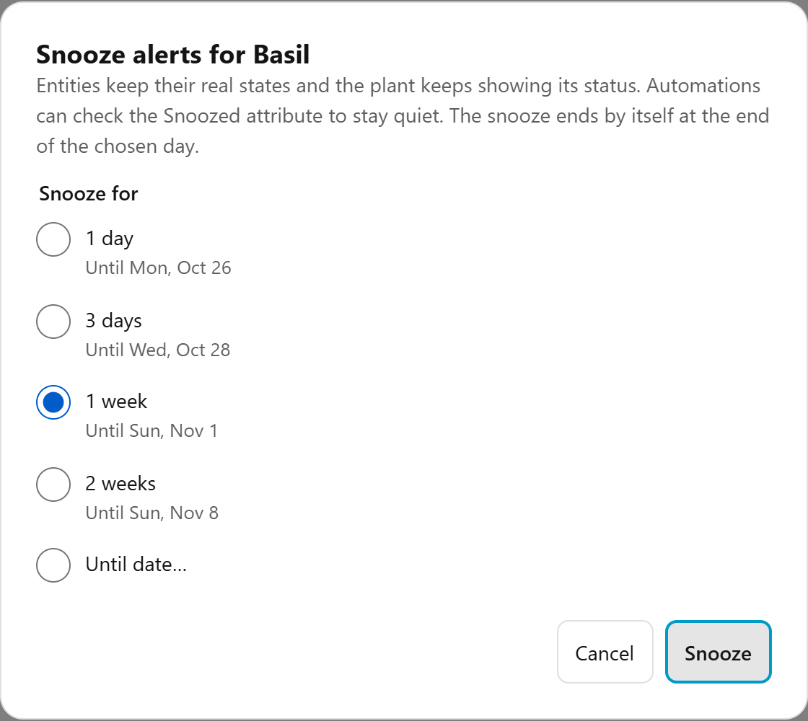

# Getting started

This page shows the Smart Plants panel and how to set up a plant. Set up the integration
first, see [Installation](installation.md).

## Open the panel

Select **Smart Plants** (sprout icon) in the sidebar. Only administrators see the panel. Other
users can use the [dashboard card](dashboard-card.md).

The overview has:

- **Tiles** that filter the list: **All plants**, **Needs water**, **Problems** and
  **Sensor issues**, plus **Care due** while a care task is due. Select a tile again to show
  all plants.
- **Search** by name, area, species, category or tag, and a **sort** menu: **Needs attention
  first**, **Name** or **Group by area**.
- **One card per plant** with its photo, status and reason, soil moisture bar, other readings,
  last watering and a **Watered** button. **Watered** logs a watering now and offers **Undo**.

Each plant shows one status, the most urgent first: *Needs water*, *Too wet*, a named problem
such as *Too little light*, *No recent data*, *No main sensor*, *No moisture sensor* (or
*No sensors*), then *Healthy*. A paused plant shows *Paused*.

The **⋮** menu has **Add plant**, **Notifications…**, **Snooze all plants…** and links to the
integration options and this documentation.

## Add a plant

Select **Add plant**. The wizard has three steps and saves nothing until you select
**Create plant**. Only the name is required.

1. **Plant.** Enter a name and pick an **Area**. The plant's device goes into that area, and
   sensors from the same area are suggested in the next step. You can add a photo. Large
   photos are scaled down.
2. **Sensors.** Pick a **Soil moisture sensor**. It drives the watering alerts. Sensors from
   the area appear under **Suggested from** *area*. **Add another sensor** adds temperature,
   humidity, light, fertilizer level, soil temperature, CO₂ or battery. Without a sensor, the
   button reads **Skip for now**.
3. **Review.** Check the summary. Two optional sections hold the rest:
   - **Species and watering targets.** Search [OpenPlantBook](openplantbook.md), or type a
     common and scientific name. The soil moisture targets **Needs water below**, **Ideal**
     and **Too wet above** start at the defaults or the species values. Change one to set it
     for this plant.
   - **More details.** Date acquired, placement, category and tags.

Select **Create plant**. Smart Plants creates the device with its entities. The last screen
offers **Open plant**, **Set up notifications**, **Back to plants** and **Add another plant**.

If the connection drops during creation, select **Retry same creation request**. A retry
never creates a second plant.

## Use the plant page

Select a plant to open its page. The header shows the photo, status with every reason and up
to four readings, with **Watered** and **Log care** next to it.

The page has four tabs:

- **Overview.** Readings with their targets, a history chart, recent care, details about the
  plant, and the **Automations** card (see
  [See which automations use a plant](automations.md#see-which-automations-use-a-plant)).
- **Sensors.** The assigned sensors, settings for readings with several sensors, and
  **Troubleshooting** with the health score and every problem check.
- **Care.** The care log and the care plan, see [Care](care.md).
- **Settings.** Name, area, photo, species, targets, more details, pause and delete.

The **⋮** menu in the top bar has **Notifications…**, **Snooze alerts…**, **Open device**,
**Download diagnostics**, **Pause monitoring** and **Delete plant**.

### Read the history chart

The history chart on the **Overview** tab shows one reading over **24 h**, **7 days**,
**30 days** or **1 year**. The line is the average, the light band the lowest to highest value,
and the green band the target range. Dotted lines mark care entries, one color per care type.

Select a point on the chart to pin its value. A pinned value offers **Log care at this time**
for care you forgot to log, or **Log watering at this time** and **Log other care** on the soil
moisture chart. For soil moisture, a line below the chart says how fast the soil dries and
when it reaches the minimum.

The chart uses Home Assistant's long-term statistics of the plant's own sensor, so it continues
when you replace a sensor.

## Assign sensors

Open the plant's **Sensors** tab.

- **Assigned sensors** lists each sensor with its value and last update. Its **⋮** menu changes
  the sensors of that reading, selects **Use as main sensor**, or removes the sensor.
- **Add sensor** offers the readings without a sensor. The first sensor of a reading is its
  main sensor.
- **Several sensors for one reading** sets, per reading, **Combine readings** (**Main sensor
  only**, **Average**, **Lowest** or **Highest**), the **Main sensor**, and **Not updating
  after** in seconds.

The picker shows sensors whose device class and unit fit the reading. Tick **Show all sensors,
including ones that don't look like a match** for others, or type an entity ID and press
Enter for a sensor that is unavailable right now. A reading takes up to 32 sensors.

[Sensors and health](sensors-and-health.md) explains units, combining and staleness.

## Change thresholds

Open the plant's **Settings** tab.

- **Soil moisture targets** has **Needs water below**, **Ideal** and **Too wet above**. Leave a
  field empty for the default, or select **Reset to defaults**. Then select **Save targets**.
  The values are whole numbers from 1 to 99, at least 4 apart.
- **Other targets** lists the other checks, such as *Temperature stress*. Select **Edit
  thresholds**, change the values and select **Save thresholds**. **Inherit all built-in
  defaults** resets a check.

The defaults are in [Sensors and health](sensors-and-health.md#built-in-thresholds).

## Add a photo

Add a photo under **Photo** on the **Settings** tab. JPEG, PNG and WebP work, up to 40 MiB and
64 megapixels. The browser scales a photo to 2048 × 2048 pixels and 5 MiB, and Smart Plants
stores it as WebP without metadata such as the location. Every signed-in user can view
photos. Only administrators can change them.

## Edit plant details

On the **Settings** tab, **Rename** changes the name of the plant and its device. Entity IDs
stay the same. **Change area** moves the device. **More details** holds placement, sun and
rain exposure, container, date acquired, category and tags.

If someone else saves the same plant while you edit, the panel shows what changed before you
save.

## Snooze alerts while you're away

A snooze mutes a plant's alerts. Open the plant and select **⋮ > Snooze alerts…**, then pick
**1 day**, **3 days**, **1 week**, **2 weeks** or **Until date…** (up to a year). The snooze
lasts until the end of that day in Home Assistant's time zone.

A snoozed plant shows **Snoozed until** *date* with **Resume**. Its status and readings stay
real. The tiles other than **All plants** leave it out of their counts.

To snooze every plant, select **⋮ > Snooze all plants…** on the overview (shown from two active
plants). A plant snoozed until later keeps its own end. **Resume all** ends every snooze. Both
offer **Undo**.

The Smart Plants triggers and the plant report skip snoozed plants. When the snooze ends and
the plant still needs water, the trigger fires once. See [Snooze alerts](automations.md#snooze-alerts)
for the actions.

## Pause or delete a plant

Use the **Settings** tab under **Manage**, or the **⋮** menu.

- **Pause monitoring** stops the checks. The plant's entities become unavailable and keep
  their history. Pausing ends a snooze.
- **Resume monitoring** starts the checks again.
- **Delete plant** removes the plant, its device and entities, photo and care history. You
  can't undo this. Update the automations that used it.

## Next steps

- [Care](care.md): log care and set up reminders.
- [Notifications](notifications.md): a daily report or a message when a plant needs water.
- [Automations](automations.md): triggers, conditions and actions.
